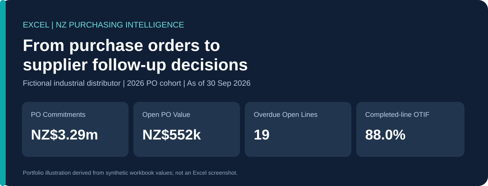
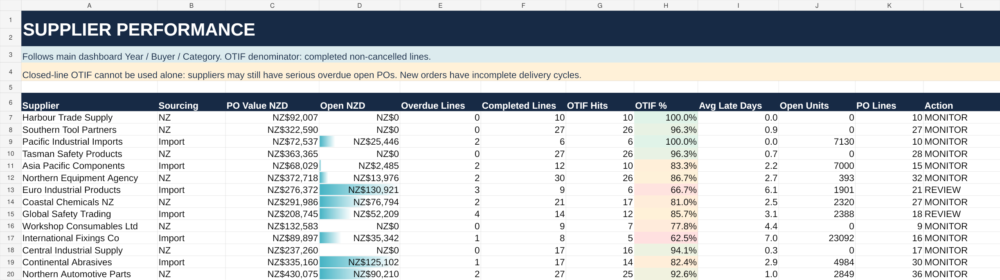
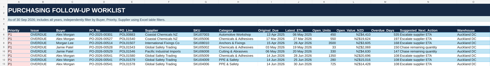
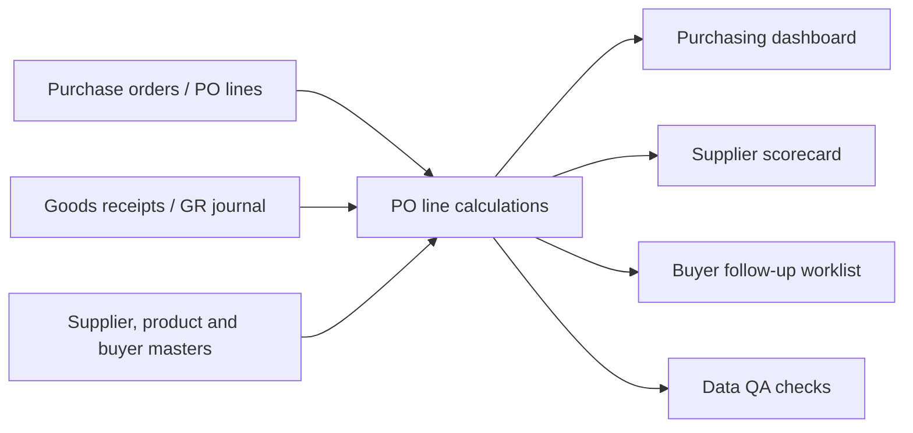

# Purchasing Operations & Supplier Performance Intelligence

**An Excel decision-support case study for a fictional New Zealand industrial distributor.**

> **Portfolio disclosure:** This is an **independent, simulated project**. All company, buyer, supplier, product, price, purchase order and receipt data are synthetic. The fictional business is **Kauri Industrial Distribution NZ**. All monetary amounts are **NZD excluding GST**.

**[Business walkthrough](docs/01_business_story.md)** · **[Technical walkthrough](docs/02_technical_implementation.md)** · **[KPI definitions](docs/03_kpi_dictionary.md)** · **[QA & limitations](docs/04_validation_and_limitations.md)**

## Results at a glance — no Excel download required

**Reporting basis:** Purchase orders issued in 2026, all buyers and categories, measured at **30 September 2026**. All amounts are simulated NZD excluding GST.

| Purchasing KPI | 2026 result | What a manager learns |
|---|---:|---|
| Purchase-order commitments | **NZ$3,293,324** | Total eligible ordered value |
| Received value | **NZ$2,740,838** | Quantity received, valued at PO price |
| Outstanding PO value | **NZ$552,486** | Undelivered commitment (16.8% of ordered value) |
| Overdue open PO lines | **19** | Open lines past original due date |
| PO-line completion rate | **80.1%** | Eligible lines fully received |
| Completed-line on-time/in-full | **88.0%** | On-time among *completed* lines only |

**A transparent check:** `NZ$3,293,324 − NZ$2,740,838 = NZ$552,486`. See the **[evidence and reproducibility notes](docs/08_evidence_and_reproducibility.md)** for scope, calculation rules, limitations, source counts and all eight recorded data-quality checks. Machine-readable summaries: **[KPI CSV](evidence/2026_kpi_snapshot.csv)** · **[Supplier CSV](evidence/2026_supplier_exposure.csv)** · **[Category CSV](evidence/2026_category_exposure.csv)** · **[QA CSV](evidence/validation_summary.csv)**.

**Decision-oriented interpretation:** Open value is not synonymous with overdue value. Purchasing staff should first identify overdue commitments, then confirm supplier ETAs and internal urgency. OTIF for completed lines must be interpreted alongside open overdue lines.

## Visual walkthrough

**Supplier performance:** Where is outstanding value concentrated, and which supplier relationships deserve a closer review?

**Purchasing action queue:** Which purchase-order lines need a buyer follow-up?

## Explore the evidence

| Audience | Start here |
|---|---|
| **Recruiter / Purchasing Manager** | [Business story](docs/01_business_story.md), then [business insights](docs/05_insights_and_recommendations.md) |
| **Technical reviewer** | [Calculation and reconciliation evidence](docs/08_evidence_and_reproducibility.md), then [Excel modelling details](docs/02_technical_implementation.md) |
| **Data reviewer** | [Aggregated CSV tables](evidence/2026_kpi_snapshot.csv) and [validation log](docs/04_validation_and_limitations.md) |

**Optional Excel artifact:** [View/download the original Excel prototype](assets/NZ_Purchasing_Operations_Intelligence_Portfolio.xlsx). The main findings and methodology are fully readable on GitHub without opening Excel. The workbook is provided as supplementary material for reviewers who want to inspect formula-bearing sheets, filters and receipt records. **The CSV summaries are aggregate evidence, not an independently reproducible transaction-level audit.**

## The business problem

A purchasing team at a multi-warehouse industrial distributor manages purchase orders to domestic and overseas suppliers. Orders may be delivered in multiple receipts, arrive late, remain partially outstanding or be cancelled. A broad company-level dashboard makes it hard for buyers to identify **which supplier to contact, which PO line is at risk and what value is still undelivered**.

The project asks a practical question:

> **How can a purchasing manager monitor outstanding PO exposure, spot delivery exceptions and direct buyers to the suppliers needing follow-up — without mixing in sales, HR or warehouse KPIs?**

## What the workbook delivers

| View | Who uses it | Question answered |
|---|---|---|
| `DASHBOARD` | Purchasing Manager | How much is ordered, received and outstanding, and where are delivery issues? |
| `FOLLOW_UP_QUEUE` | Purchasing Coordinator | Which PO line should I chase today, and what should I ask the supplier? |
| `SUPPLIER_SCORECARD` | Purchasing Manager / Team Leader | Which suppliers have open exposure, overdue lines or weaker completed-line delivery performance? |
| `CATEGORY_SPEND` | Purchasing / Category Lead | Which product categories account for the most purchasing commitments and remaining exposure? |
| `DATA_QA` | Analyst / reviewer | Can the computed figures be reconciled to receipt and PO records? |

The workbook contains raw-style `PO_LINES` and `GOODS_RECEIPTS` tables, supplier/product/buyer master tables, a KPI dictionary, source notes and a brief case study. **It is a formula-based Excel project, not a Power BI or SQL project.**

## Snapshot: what the synthetic data tells us

**As at 30 September 2026; dashboard filters: PO issue year 2026, all buyers, all categories.** These are illustrative outputs from a fictional scenario, not realised business results.

| KPI | Workbook result | Meaning |
|---|---:|---|
| PO commitment value | **NZ$3,293,324** | Value ordered on non-cancelled PO lines issued in 2026 |
| Goods received value | **NZ$2,740,838** | Accepted receipts to the snapshot date valued at PO unit prices |
| Open PO value | **NZ$552,486** | Remaining undelivered value |
| Overdue open PO lines | **19** | Open lines whose original due dates are before the snapshot |
| PO-line completion | **80.1%** | Share of non-cancelled 2026 lines received in full |
| Completed-line OTIF | **88.0%** | Share of completed lines received fully by their original due date |
| Outstanding units | **52,057** | Unreceived units; units across SKUs should not be treated as interchangeable |
| Due in next 14 days | **13 lines** | Outstanding lines approaching original due date |

**Interpretation:** Completing 80.1% of lines does not mean that 80.1% of open value has been received. Also, **88.0% OTIF is calculated only over completed lines**; uncompleted overdue lines are excluded from its denominator. Review that number alongside the open-order and overdue metrics to avoid a misleading supplier assessment.

### Where a manager should look first

In this simulated 2026 cohort, **Power Tools (NZ$171,168)** and **Chemicals & Adhesives (NZ$138,636)** together represent approximately **56% of open value**. The largest individual supplier open positions shown on the scorecard include **Euro Industrial Products (NZ$130,921)**, **Continental Abrasives (NZ$125,102)** and **Northern Automotive Parts (NZ$90,210)** — collectively approximately **63%** of the 2026 open value.

This suggests a focused review of exposure concentration, not a conclusion that those suppliers have caused stock-outs or actual financial losses. Confirm the outstanding quantities, revised ETA and operational urgency before taking action. See **[findings and proposed actions](docs/05_insights_and_recommendations.md)**.

## For non-technical readers

Start with **[The business story](docs/01_business_story.md)**. It explains the user, the purchasing problem, the decisions and the three things to notice in a monthly management review. The results, evidence tables and proposed decisions are readable directly on this repository; the Excel workbook is optional.

## For technical readers

Start with **[Technical implementation](docs/02_technical_implementation.md)** to see the one-PO-line-to-many-receipts relationship, grains, calculated fields, filter rules and Excel logic. Continue to **[KPI definitions](docs/03_kpi_dictionary.md)** and **[validation](docs/04_validation_and_limitations.md)**. The [evidence page](docs/08_evidence_and_reproducibility.md) and static [CSV summaries](evidence/2026_kpi_snapshot.csv) make the reported aggregates inspectable without Excel. The optional workbook contains the underlying synthetic line-level transactions and formulas.

## Optional Excel prototype

The Excel workbook is supplementary rather than required for understanding this case study. Review the [static numbers, checks and methods](docs/08_evidence_and_reproducibility.md) first. If desired, [open the workbook](assets/NZ_Purchasing_Operations_Intelligence_Portfolio.xlsx) in desktop Microsoft Excel to inspect formulas, filters and the raw-style synthetic transaction tables.

## Technical scope and honesty

- Tool: **Microsoft Excel**, including `SUMIFS`, `COUNTIFS`, calculated columns, formatting, data validation and charts.
- Input grain: **one row per PO line** and **one row per goods receipt event** (several receipts can relate to the same PO line).
- The dataset is **synthetic**, with 1,159 PO lines, 1,394 goods receipt events, 14 suppliers, 95 products and 5 buyers over 2024–2026.
- **No supplier invoices, actual purchase spend, verified savings, inventory-on-hand or customer demand** are available. These outcomes are not claimed.
- The source workbook's `CASE_STUDY!D25` still contains **outdated record counts from an earlier draft**. The accurate counts for this version are **1,159 PO lines and 1,394 goods receipts**. The workbook is otherwise kept in the user's chosen formatting to preserve its three embedded Excel charts. See [review notes](docs/04_validation_and_limitations.md#publication-review-note).

## Project documents

| Document | Why read it |
|---|---|
| [Business story](docs/01_business_story.md) | Problem, users, business questions, acceptance criteria |
| [Technical implementation](docs/02_technical_implementation.md) | Table grains, data relationships, Excel logic, filter behaviour |
| [KPI definitions](docs/03_kpi_dictionary.md) | Calculations, eligible records, denominators and exclusions |
| [Validation and limitations](docs/04_validation_and_limitations.md) | Reconciliation checks, interpretive and synthetic-data caveats |
| [Insights and proposed actions](docs/05_insights_and_recommendations.md) | Management interpretation and action plan |
| [How to explore](docs/06_how_to_explore.md) | Reviewer walkthrough and interview demo script |
| [Sources and transparency](docs/07_sources_and_provenance.md) | Reference links and what was or was not sourced |
| [Evidence and reproducibility](docs/08_evidence_and_reproducibility.md) | Reported aggregates, arithmetic checks, methods and verification limits |

## Why this project matters

Rather than building a company-wide dashboard, this case study focuses on a **single function** and the purchasing decisions it must make: monitor PO commitments, reconcile deliveries, identify overdue exceptions and prioritise supplier follow-up. The business story, formulas and validation are intentionally all inspectable.

*Project type: independent portfolio case study | Reporting snapshot: 30 September 2026 | Status: simulated analysis, no real-world implementation or measured savings.*
