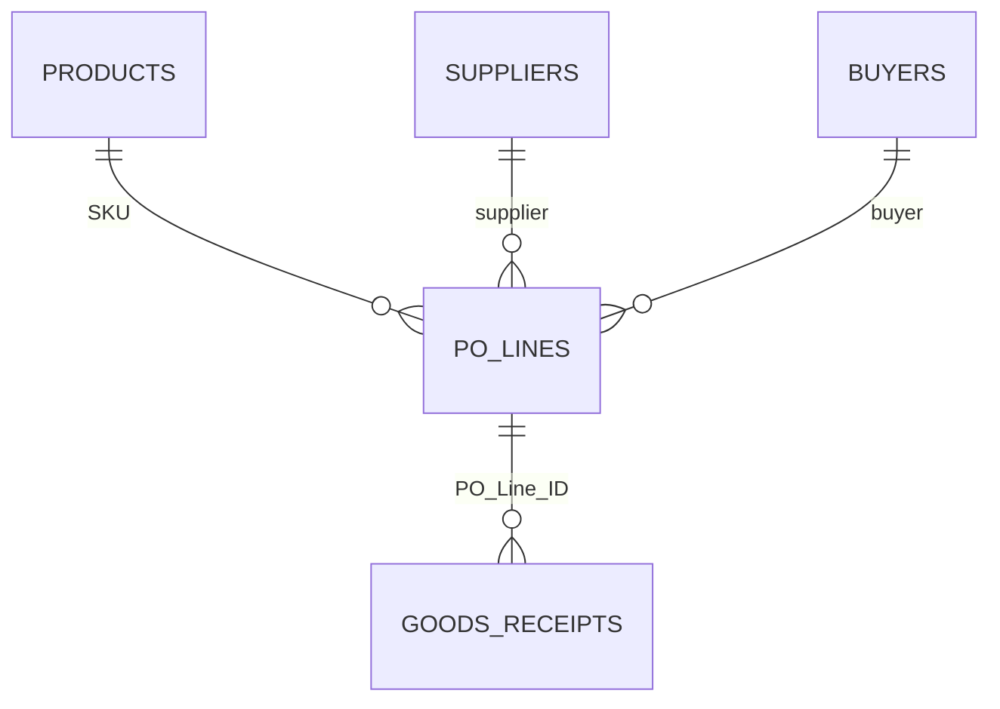

# Technical implementation

## Architecture and grain

This is an **Excel-only** project. No SQL, Power BI or live SAP/ERP integration is claimed.

| Sheet | Grain | Purpose |
|---|---|---|
| `PO_LINES` | One row per PO line | Ordering commitments and line-level derived metrics |
| `GOODS_RECEIPTS` | One row per goods receipt event | Multiple partial receipts can belong to a single line |
| `SUPPLIERS` | One row per supplier | Vendor attributes |
| `PRODUCTS` | One row per SKU | Category / UOM / product attributes |
| `BUYERS` | One row per buyer | Responsibility |
| `DASHBOARD` | Filtered KPI view | Management oversight |
| `FOLLOW_UP_QUEUE` | Open order worklist | Independent all-year Excel table filtering |



The relationships above are **logical**, not enforced database constraints.

## Avoiding duplicated commitments

A line may be received in several deliveries. Directly joining `PO_LINES` to `GOODS_RECEIPTS` and summing `Ordered_Units` would count a PO-line order more than once. The workbook aggregates receipt quantity to the PO line and retains a separate receipt journal.

### Selected Excel formulas

Committed line value in `PO_LINES!T6`:

```excel
=IF(Q6="Y",0,M6*N6)
```

Remaining open units in `PO_LINES!U6`:

```excel
=IF(Q6="Y",0,MAX(0,M6-R6))
```

Remaining open value in `PO_LINES!V6`:

```excel
=U6*N6
```

Here, Q is the cancelled flag, M ordered units, N PO unit price and R accepted units.

The dashboard uses `SUMIFS` and `COUNTIFS` over line-level derived fields. User selections are `DASHBOARD!B5` PO issue year, `F5` buyer, and `J5` category. Reporting snapshot is **30 Sep 2026**.

## Filter boundaries

- Main dashboard and supplier scorecard follow dashboard filter choices.
- Category analysis maintains an all-category comparison.
- Follow-up queue covers **all PO issue years** and is filtered independently as an Excel table.
- **PO issue year** is not the same as receipt posting year.

## Delivery logic

Completed-line on-time/in-full evaluates whether the full ordered quantity was received by the original due date, including the last of multiple receipts. The denominator includes completed eligible PO lines only. Therefore, examine overdue *open* lines separately.

## Public reproducibility note

The source Excel workbook is not included in this repository. Technical readers can review the calculation logic and published aggregates, but cannot independently re-run each row-level transaction. The [evidence page](08_evidence_and_reproducibility.md) explains what is and is not verifiable.

## Operational limitations

No automated data refresh, SAP extraction, foreign-key enforcement, invoice settlement, live ETA, stock-on-hand, supplier defect outcomes or freight/FX-adjusted landed cost is supplied. The PO-price-based receipt value should not be presented as an invoice-paid amount.
