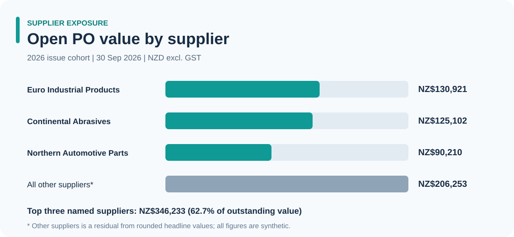

# Scenario insights and recommended purchasing actions

> **All findings use synthetic data.** Report filter: PO issued in 2026, all buyers and product categories, snapshot **30 September 2026**.

## 1. Remaining PO commitments

From **NZ$3,293,324** of eligible PO commitments, **NZ$2,740,838** has been received at PO unit prices, leaving **NZ$552,486** open, approximately **16.8%** of committed value.

**What it means:** Open commitment is not necessarily overdue. First divide the worklist into not yet due, due soon and past original due date.

**Action:** Set a weekly purchasing exception review, prioritised by due date and exposure.

## 2. Category exposure

**Power Tools** account for approximately **NZ$171,168** and **Chemicals & Adhesives** approximately **NZ$138,636** in open value. Together they represent around **56%** of total remaining commitment.

**Action:** Review the largest category positions for operational urgency and supplier follow-up. Do not infer actual stock-outs; the dataset has no demand or on-hand inventory records.

## 3. Supplier exposure

The largest supplier outstanding positions include:

- Euro Industrial Products - approximately **NZ$130,921**
- Continental Abrasives - approximately **NZ$125,102**
- Northern Automotive Parts - approximately **NZ$90,210**

Combined, these make approximately **63%** of the 2026 open value.

**Action:** Review these supplier positions by open line, deadline and revised ETA rather than treating open value as supplier failure.

### Supplier exposure chart

**Reading the chart:** The three named suppliers account for about 62.7% of open PO value in the 2026 cohort. "All other suppliers" combines remaining exposure; this aggregation does not imply the named suppliers have poor delivery performance. Follow up on due dates and individual PO lines before escalation.

## 4. Completed-line OTIF needs context

**88.0%** completed-line OTIF is calculated only for fully received lines; **19** open lines are overdue and the overall completion rate is **80.1%**.

**Action:** Put completed-line delivery reliability next to current overdue backlog in the management discussion; otherwise performance can appear better than the worklist suggests.

## Practical buyer escalation loop

1. Filter overdue P1/P2 work items.
2. Check PO amendment and historical receipt records.
3. Ask supplier to confirm unshipped quantity and credible delivery date.
4. Inform internal requestor where urgency is confirmed.
5. Record buyer follow-up and re-evaluate at the next review.

These are **recommended actions**, not completed interventions or verified savings.
